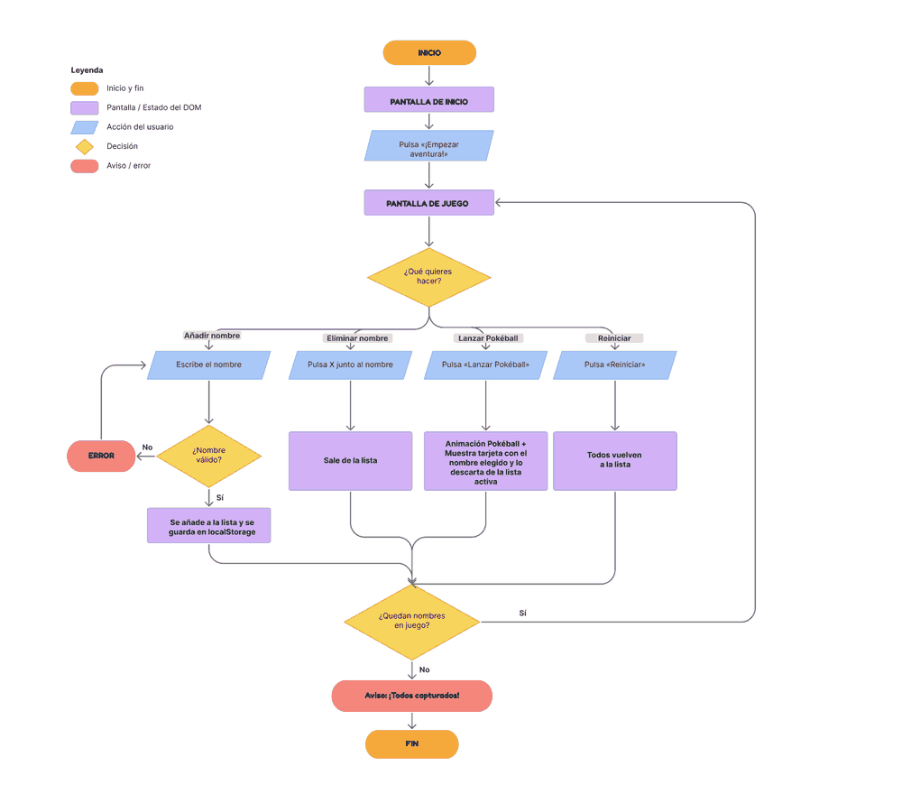
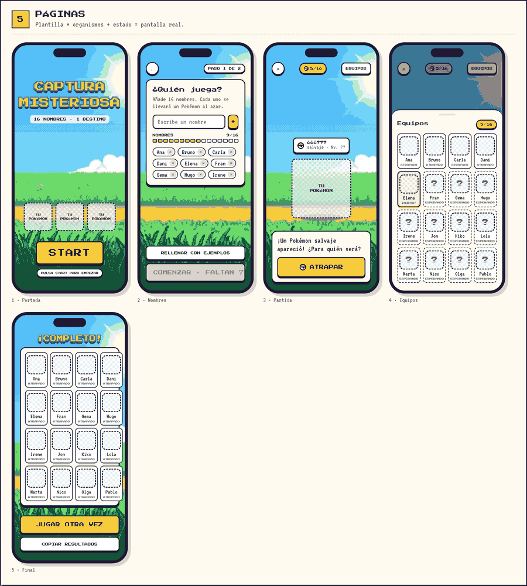
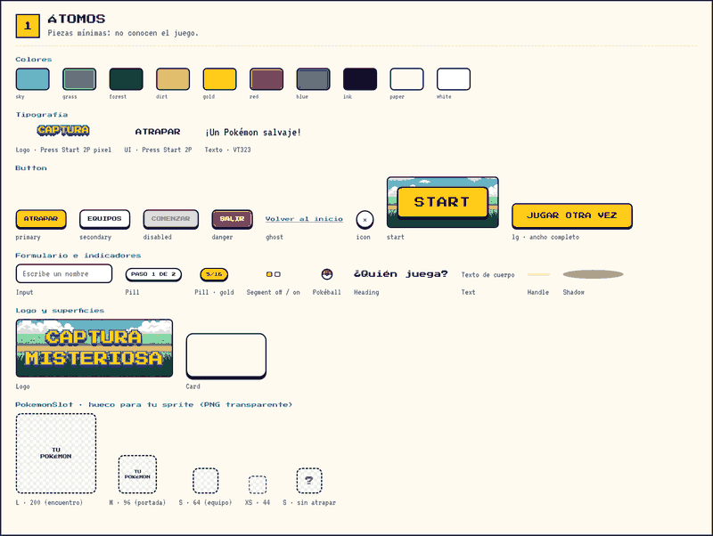
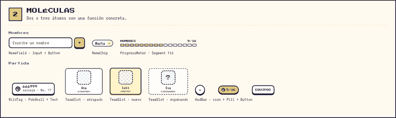
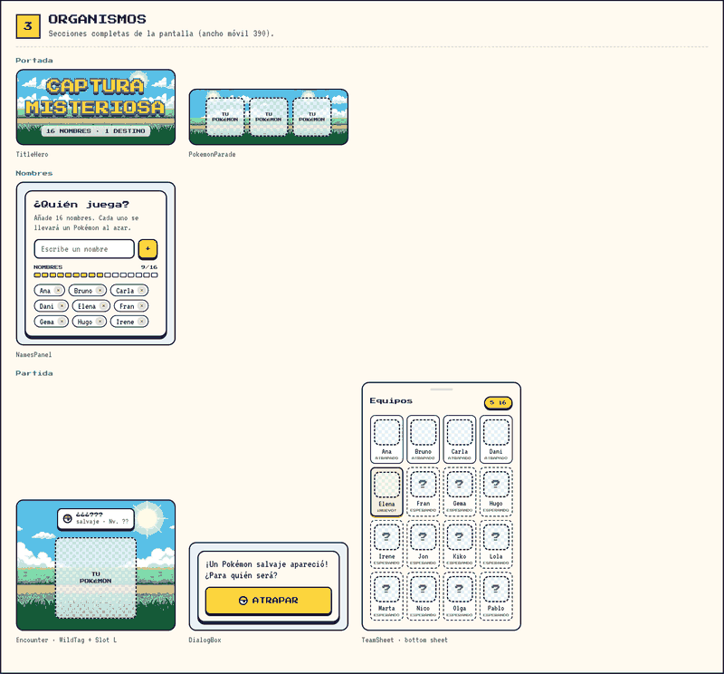
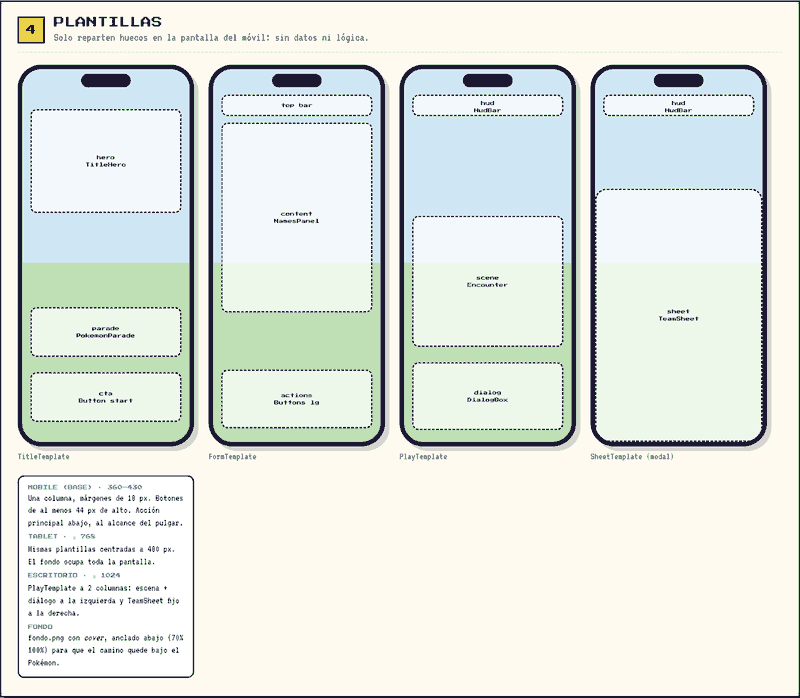
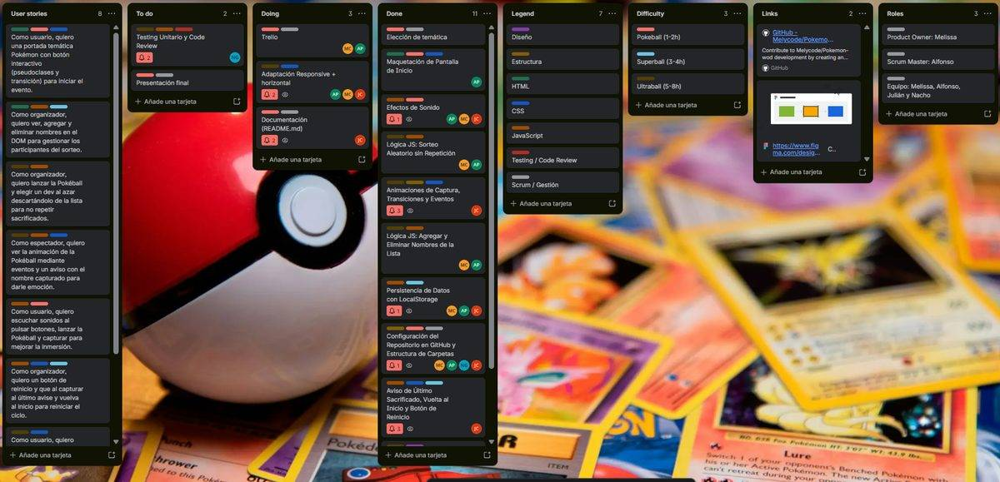

# Captura Misteriosa

**Wheel of Doom con Pokémon.** Una forma justa y aleatoria de repartir 16 Pokémon entre 16 jugadores, en pixel art.

## Índice

- [Briefing](#briefing)
- [El proyecto](#el-proyecto)
- [Cómo se juega](#cómo-se-juega)
- [Maquetas](#maquetas)
- [Tecnologías y herramientas](#tecnologías-y-herramientas)
- [Metodología](#metodología)
- [Estructura del proyecto](#estructura-del-proyecto)
- [Cómo ejecutarlo](#cómo-ejecutarlo)
- [Equipo](#equipo)

## Briefing

La asociación **Sacrificios SA**, organizadora de eventos como *La Purga*, *El Laberinto*, *Los Juegos del Hambre* o *El Juego del Calamar*, nos encarga una aplicación web para su nuevo evento de sacrificio de desarrolladores y desarrolladoras. La aplicación tiene que ser **un sistema justo y aleatorio** que haga un sorteo a partir de una lista de nombres.

Requisitos principales del encargo:

- Recibir una lista de nombres y poder **añadir o eliminar** nombres.
- Elegir un nombre al azar y **mostrar un aviso** con el elegido.
- Un nombre elegido **no vuelve a salir** hasta que se reinicia la aplicación.
- Avisar cuando sale el **último nombre**.
- Tener **pantalla de inicio**, **botón de reinicio**, **animaciones**, **transiciones** y **efectos de sonido**.
- Ser **mobile first** y **responsive** en al menos dos puntos de ruptura.
- El diseño tiene que ser creativo y entretenido: **no puede ser la típica ruleta**. El tema es libre.

## El proyecto

Nuestro tema es **Pokémon**. En vez de una ruleta, cada turno aparece un **Pokémon salvaje** y, al lanzar la Poké Ball, el juego decide al azar **a qué jugador le pertenece**. Cada jugador que sale ya no vuelve a salir, igual que cada Pokémon. Al final, los 16 jugadores tienen su Pokémon.

El sorteo es justo porque en cada lanzamiento todos los jugadores que quedan tienen la misma probabilidad de salir.

## Cómo se juega

1. **Portada.** Aparece el aviso de cookies. Después, mantén pulsado **START** hasta que se llene la barra.
2. **¿Quién juega?** Escribe 16 nombres o pulsa **RELLENAR CON EJEMPLOS**. No se pueden repetir nombres y cada uno se puede borrar con la **×**. Con los 16 nombres se activa **¡COMENZAR PARTIDA!**.
3. **Captura.** Aparece un Pokémon salvaje. Pulsa **ATRAPAR**: la Poké Ball sale disparada y se descubre el jugador al que le ha tocado.
4. **Equipos.** Después de cada captura se abre la hoja de equipos, con los jugadores que ya tienen Pokémon y los que siguen esperando. También se abre con el botón **EQUIPOS**.
5. **Resultados.** Con los 16 Pokémon repartidos aparece **VER RESULTADOS FINALES**. Desde ahí se pueden **COPIAR RESULTADOS** o **JUGAR OTRA VEZ**.

Con la **×** de la partida se vuelve a la lista de jugadores y se reinicia la captura.

## Maquetas

Diseñamos la interfaz en **Figma** siguiendo **Atomic Design**: primero las piezas pequeñas y después las pantallas completas. Antes de diseñar las pantallas hicimos el diagrama de flujo de la aplicación.

Archivo de Figma: [Captura misteriosa](https://www.figma.com/design/oa9YKxtbhnVnhd6Jt2w5qy/Captura-misteriosa)

### Diagrama de flujo



### Páginas

Las cinco pantallas del juego en móvil: portada, nombres, partida, equipos y final.



### Átomos

Colores, tipografías, botones, iconos y otras piezas básicas.



### Moléculas

Combinaciones de átomos, como el campo para añadir nombres o las etiquetas de jugador.



### Organismos

Bloques completos, como la tarjeta de nombres, el encuentro con el Pokémon o la hoja de equipos.



### Plantillas

La estructura de cada pantalla, antes de añadir el contenido real.



## Tecnologías y herramientas

**Tecnologías**

- HTML
- CSS (diseño mobile first y media queries)
- JavaScript (DOM, eventos y funciones)

**Herramientas**

- Figma, para el diseño y el prototipo
- Visual Studio Code
- Trello, para el tablero Kanban
- Git y GitHub

**Recursos externos**

- Fuentes *Press Start 2P* y *VT323* de Google Fonts
- Sprites e imágenes de fondo alojados en Cloudinary y en [PokeAPI/sprites](https://github.com/PokeAPI/sprites)
- Efectos de sonido creados con la Web Audio API y música en MP3

No hay backend: todo funciona en el navegador.

## Metodología

Trabajamos con metodologías ágiles:

- **Scrum**, con dos sprints de dos semanas, daily cada día y retrospectiva al final de cada sprint.
- **Kanban** en Trello, con historias de usuario y tareas.
- **Git** con una rama por tarea. Cada uno abre un pull request hacia `dev`, que es la rama donde se junta el trabajo del equipo.

### Roles de Scrum

| Rol | Persona |
|---|---|
| Product Owner | Melissa |
| Scrum Master | Alfonso |
| Equipo de desarrollo | Melissa, Alfonso, Julián y Nacho |

### Tablero Kanban

El tablero de Trello tiene las historias de usuario, las columnas *To do*, *Doing* y *Done*, y etiquetas por tecnología y por dificultad: **Pokéball** (1-2 h), **Superball** (3-4 h) y **Ultraball** (5-8 h).



### Historias de usuario

- Como usuario, quiero una portada temática Pokémon con botón interactivo (pseudoclases y transición) para iniciar el evento.
- Como organizador, quiero ver, agregar y eliminar nombres en el DOM para gestionar los participantes del sorteo.
- Como organizador, quiero lanzar la Pokéball y elegir un dev al azar, descartándolo de la lista para no repetir sacrificados.
- Como espectador, quiero ver la animación de la Pokéball mediante eventos y un aviso con el nombre capturado para darle emoción.
- Como usuario, quiero escuchar sonidos al pulsar botones, lanzar la Pokéball y capturar para mejorar la inmersión.
- Como organizador, quiero un botón de reinicio y que al capturar al último avise y vuelva al inicio para reiniciar el ciclo.

## Estructura del proyecto

```
Pokemon-wod/
├── index.html        # Todas las pantallas del juego
├── styles.css        # Estilos y diseño responsive
├── script.js         # Lógica del juego
├── sonido-start.mp3  # Sonido al mantener START
├── tema-fondo.mp3    # Música de la portada
├── bg-ost.mp3        # Música durante la partida
└── docs/
    └── maquetas/     # Imágenes de Figma y Trello para este README
```

El código está dividido en cinco partes, una por pantalla, marcadas con comentarios (`<!-- PARTE N -->` en el HTML y `// PARTE N` en el JS):

| Parte | Pantalla | Qué hace |
|---|---|---|
| 1 | Portada | Botón START de mantener pulsado, aviso de cookies y música |
| 2 | Jugadores | Formulario de 16 nombres con validación y barra de progreso |
| 3 | Juego | Pokémon salvaje, lanzamiento de la Poké Ball y sorteo del jugador |
| 4 | Equipos | Hoja con la cuadrícula 4x4 de jugadores y su Pokémon |
| 5 | Final | Resultados, copiar al portapapeles y volver a jugar |

## Cómo ejecutarlo

```bash
git clone https://github.com/Melycode/Pokemon-wod.git
cd Pokemon-wod
git checkout dev
```

Abre `index.html` en el navegador o usa la extensión *Live Server* de Visual Studio Code. Hace falta conexión a internet para cargar las imágenes y las fuentes.

## Equipo

| Nombre | GitHub | Parte |
|---|---|---|
| Melissa | [Melycode](https://github.com/Melycode) | Pantalla de jugadores y juego |
| Alfonso | [deterry69](https://github.com/deterry69) | Portada, cookies y música |
| Julián | [JulianChavezdev](https://github.com/JulianChavezdev) | Hoja de equipos y últimos detalles |
| Nacho | | Pantalla final |

---

Proyecto educativo sin ánimo de lucro. Pokémon y sus sprites pertenecen a Nintendo, Game Freak y The Pokémon Company.
